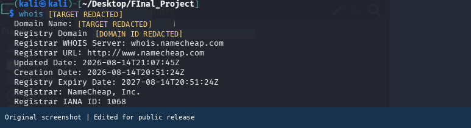
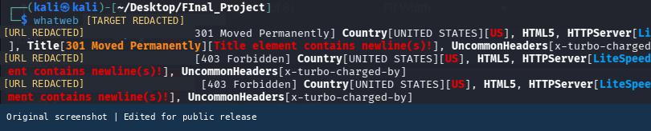
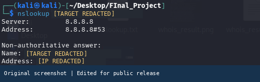
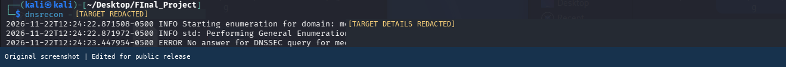
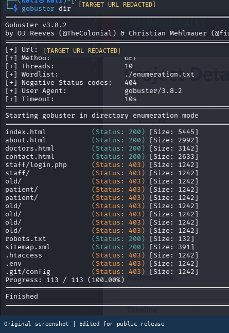
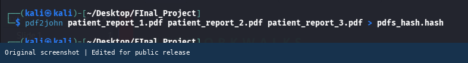
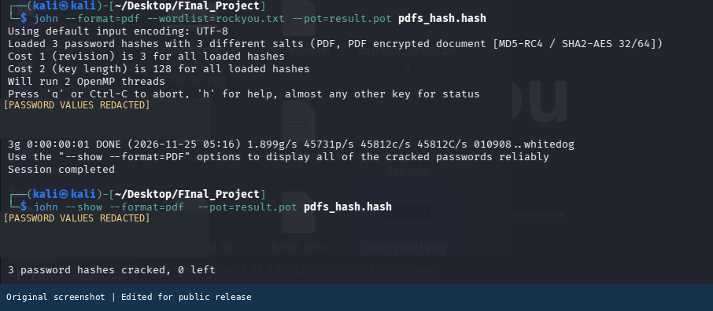
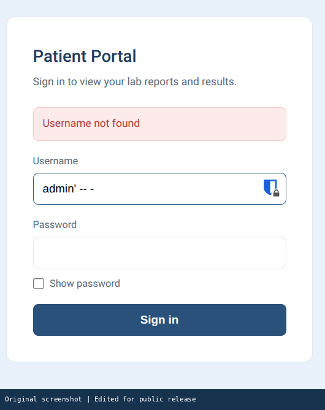
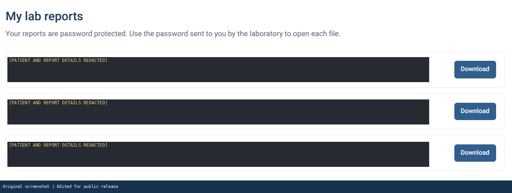

# MEDIROZA
## Penetration Testing Report

**PUBLIC EDITION**

| Engagement | Information |
|---|---|
| Project | Mediroza — Final Internship Project |
| Organization | Networkwalks |
| Program | Cybersecurity & Ethical Hacking |
| Batch | B084 |
| Assessor | Mardochée BONOU |
| Assessment period | 22–25 November 2026 |
| Target | Demonstration hospital — target details redacted |
| Classification | Public |
| Overall risk | HIGH |

---

# 01. Executive Summary

## 1.1 Overview

This report presents the results of a penetration testing assessment conducted as part of the Networkwalks Cybersecurity & Ethical Hacking internship, Week 4.

The assessment focused on identifying security weaknesses affecting a hospital's web application, patient document access mechanisms and exposed data storage.

The investigation covered reconnaissance, service enumeration, examination of the patient portal, recovery of protected PDF documents and analysis of an exposed SQL database backup.

Four principal security findings were identified:

- **F-01 — SQL Injection:** A SQL injection input was reported to provide access to patient report links.
- **F-02 — Weak PDF Password Protection:** Three protected PDF documents were successfully opened following offline password recovery.
- **F-03 — Information Disclosure:** Operational information was discovered in PDF metadata.
- **F-04 — Exposed SQL Backup:** A database backup was accessible through a direct HTTP request, exposing employee and shareholder information.

The assessment demonstrates potential confidentiality risks involving medical documentation and organizational information.

The overall risk is assessed as **HIGH**, primarily due to the reported unauthorized access to patient reports and the exposure of the SQL backup.

The assessment did not demonstrate database modification, administrative server control or service disruption.

## 1.2 Summary of Findings

| ID | Security Finding | Severity | Validation |
|---|---|---|---|
| F-01 | SQL Injection — Patient Portal | High (provisional) | Partially documented |
| F-02 | Weak PDF Password Protection | High | Verified |
| F-03 | Information Disclosure Through PDF Metadata | Low | Verified |
| F-04 | Exposed SQL Database Backup | High | Verified |

---

# 02. Engagement Overview

## 2.1 Authorization and Disclaimer

This assessment was conducted as part of an authorized educational exercise under the Networkwalks internship program.

Testing was limited to the environment covered by the supplied project authorization.

The assessment excluded:

- Social engineering.
- Denial-of-service testing.
- Testing outside the authorized scope.
- Unauthorized modification of production data.

This report is a public, redacted edition. Sensitive information, including patient records, employee identities, individual salaries, shareholder details, document passwords and original verification hashes, has been withheld.

The demonstration domain and repository dataset are synthetic elements. Original screenshots have been redacted for publication.

## 2.2 Scope

The assessment covered the following components:

| Component | Assessment Objective |
|---|---|
| Web application | Identify potential weaknesses in application access controls |
| Patient portal | Examine authentication and document access |
| PDF documents | Assess document protection and metadata exposure |
| Web-accessible storage | Identify exposed backup files |
| SQL backup | Analyze the confidentiality impact of exposed records |

## 2.3 Assessment Methodology

The assessment followed a structured penetration testing workflow:

1. **Reconnaissance:** Collection of domain, DNS and web technology information.
2. **Enumeration:** Identification of accessible services and application paths.
3. **Initial Access Assessment:** Examination of the patient portal and reported SQL injection.
4. **Document Security Assessment:** Examination of PDF protection and metadata.
5. **Data Exposure Assessment:** Retrieval and offline analysis of the SQL backup.
6. **Reporting:** Documentation of findings, evidence, risks and remediation measures.

The analysis distinguishes between directly verified results, trainee-reported observations and conclusions that remain subject to additional evidence.

## 2.4 Tools and Technologies

| Tool | Assessment Purpose |
|---|---|
| Kali Linux | Testing environment |
| WHOIS | Domain registration information |
| nslookup / DNSRecon | DNS reconnaissance |
| WhatWeb | Web technology identification |
| Gobuster | Web path enumeration |
| Nmap | Network service identification |
| FTP Client | FTP connectivity and authentication assessment |
| pdf2john | PDF password verification data extraction |
| John the Ripper | Offline password recovery |
| ExifTool | PDF metadata examination |
| Poppler | PDF content extraction |
| curl | HTTP response and backup retrieval |
| Python / SQLite | Local database analysis |

---

# 03. Assessment Results

## 3.1 Reconnaissance and Service Enumeration

Initial reconnaissance was conducted to understand the target's external exposure and identify accessible services.

The assessment included domain registration information, DNS resolution, web fingerprinting, directory enumeration and service identification.

The collected observations provided information about the target's infrastructure and application surface.

### FTP Service Assessment

An FTP service was identified during enumeration.

The authentication attempt was rejected:

- Response `331`: The server requested the next authentication step.
- Response `530`: Authentication was rejected.

No successful FTP authentication was obtained.

This observation does not establish an FTP vulnerability.

### Enumeration Results

The assessment identified differences between directory-level and direct-file accessibility.

In particular, the legacy directory returned HTTP 403 during directory enumeration, while a direct request to the backup file returned HTTP 200.

This distinction is important: directory listing restrictions do not necessarily prevent direct access to files.

---

## 3.2 F-01 — SQL Injection in the Patient Portal

**Severity:** High (provisional)

**Affected component:** Patient portal authentication interface

### Description

During the assessment, a SQL injection input was reportedly submitted through the Username field of the patient portal.

The trainee reported that this resulted in access to the patient report download page, where three patient reports were available.

The documented input was:

`admin' -- -`

In applications that construct SQL queries through unsafe string concatenation, insufficient input handling can allow user-supplied values to alter query interpretation.

The available evidence includes the submitted input and a subsequent screenshot of the report download page.

However, the complete HTTP request, server response and database query are not archived.

Consequently, the reported SQL injection and resulting access require additional evidence for complete independent reproduction.

### Evidence

- Portal input screenshot.
- Subsequent report download page screenshot.
- Three report download controls visible.

### Impact

If confirmed, this weakness could allow unauthorized access to patient documentation.

In a healthcare environment, this represents a significant confidentiality risk because medical reports may contain sensitive personal information.

### Recommendation

- Use parameterized SQL queries for all database operations.
- Implement server-side input handling.
- Apply authorization checks to individual patient reports.
- Ensure that access to one patient's records does not grant access to other patients' documents.
- Conduct security testing of authentication and document retrieval workflows.

### Retest Criteria

The application must reject the injection attempt without altering the intended authentication query.

Authenticated users must only be able to retrieve documents for which they have explicit authorization.

---

## 3.3 F-02 — Weak PDF Password Protection

**Severity:** High

**Affected component:** Three patient PDF reports

### Description

Three patient reports were protected using the PDF Standard Security Handler, revision 3, with RC4 encryption and a 128-bit key.

Offline password recovery was conducted using extracted PDF verification data and wordlist-based testing.

All three passwords were successfully recovered, and the original documents were subsequently opened.

This demonstrates that the passwords protecting the documents were insufficiently resistant to offline guessing.

The finding concerns weak password selection rather than direct cryptographic key recovery.

### Evidence

- PDF verification data extraction screenshot.
- Password recovery screenshot showing three recovered results.
- Local verification that the three original documents could be opened.

Recovered passwords and verification hashes are withheld from this public edition.

### Impact

An individual obtaining copies of the encrypted documents could potentially recover their passwords and access their contents.

This weakens the confidentiality protection expected for medical documentation.

### Recommendation

- Avoid predictable passwords and commonly used password patterns.
- Use long, randomly generated and unique document passwords when PDF password protection is required.
- Apply access-controlled document storage rather than relying exclusively on PDF encryption.
- Review existing document distribution practices.
- Consider modern encryption mechanisms and compatible document security solutions.

### Retest Criteria

Reissued documents must resist the previously successful password-recovery approach, and document access must remain restricted to authorized users.

---

## 3.4 F-03 — Information Disclosure Through PDF Metadata

**Severity:** Low

**Affected component:** Patient report metadata

### Description

Examination of an original protected PDF revealed an operational comment containing information about a legacy backup directory.

The metadata was not available in the same form when examining a re-exported copy of the document.

The original PDF therefore remained the primary evidence source.

The metadata provided additional information about the application's document storage environment.

### Evidence

- Original PDF metadata examination.
- Recovered operational comment identifying a legacy backup location.

The original comment and associated internal information are withheld from this public edition.

### Impact

Operational metadata can unintentionally disclose internal paths, infrastructure details or other information useful during subsequent reconnaissance.

In this assessment, the information provided a clue leading to further investigation of the backup storage location.

### Recommendation

- Remove unnecessary operational comments from distributed documents.
- Review document metadata before external publication.
- Avoid including internal paths and infrastructure information in generated reports.
- Apply metadata sanitization during document generation and distribution.

### Retest Criteria

Newly distributed documents must not contain unnecessary internal operational information.

---

## 3.5 F-04 — Exposed SQL Database Backup

**Severity:** High

**Affected component:** Legacy backup storage

### Description

During the assessment, a legacy SQL backup was retrieved through a direct HTTP request.

The trainee supplied evidence of an HTTP 200 response and a SQL verification copy matching the original download.

The backup contained two relevant tables:

- `staff`: Employee information, job titles, departments and monthly salaries.
- `shareholders`: Shareholder information, ownership percentages, share counts and share classifications.

The backup was analyzed locally using SQLite.

Only the relevant INSERT statements were imported into the analysis database. The original MySQL administrative instructions were not executed.

The extraction and consistency checks were independently verified against the supplied backup.

### Evidence

- Original backup response and verification file.
- Local SQL extraction results.
- Employee and shareholder record counts.
- Data consistency checks.

### Data Exposure

The backup contained:

| Dataset | Extracted Records |
|---|---:|
| Employee records | 30 |
| Shareholder records | 10 |

The individual identities, salary amounts and ownership details are withheld from this edition.

The SQL header contained a date of 27 August 2019. However, three employment dates were later than this date.

Consequently, the assessment does not establish that the salary information represents current organizational records.

### Impact

The exposure of an internal database backup can result in unauthorized disclosure of:

- Employee personal information.
- Organizational employment information.
- Financial compensation data.
- Shareholder and ownership information.

The presence of these records in a publicly accessible backup represents a significant confidentiality risk.

### Recommendation

- Remove database backups from publicly accessible web directories.
- Store backups outside the web server document root.
- Enforce authentication and authorization for backup access.
- Apply access restrictions at the storage and infrastructure levels.
- Review server logs for previous unauthorized backup downloads.
- Identify and remove other exposed backup copies.
- Establish secure backup retention and distribution procedures.

### Retest Criteria

A direct unauthenticated request to the former backup location must no longer return the database contents.

---

# 04. Risk Assessment

## 4.1 Findings Summary

| Finding | Severity | Primary Security Impact |
|---|---|---|
| F-01 — SQL Injection | High (provisional) | Patient document confidentiality |
| F-02 — Weak PDF Passwords | High | Document confidentiality |
| F-03 — PDF Metadata Disclosure | Low | Internal information disclosure |
| F-04 — Exposed SQL Backup | High | Employee and shareholder data confidentiality |

The ratings are qualitative and reflect the available evidence and demonstrated confidentiality implications.

No CVSS scores have been assigned.

## 4.2 Positive Security Observations

Some security controls were also observed:

- HTTPS redirection was identified.
- Anonymous FTP authentication was rejected.
- Directory listing restrictions were observed on the legacy directory.

These controls do not eliminate the risks associated with direct backup access, weak document passwords or application-level security weaknesses.

An exposed port, technology fingerprint or DNS observation is not considered a vulnerability without evidence of an actual security weakness.

---

# 05. Remediation Plan

The following actions are recommended according to their priority.

| Priority | Recommended Action | Related Finding |
|---|---|---|
| Critical remediation priority | Remove publicly accessible database backups | F-04 |
| Critical remediation priority | Correct SQL query construction and enforce document authorization | F-01 |
| High remediation priority | Replace weak PDF passwords and review document access controls | F-02 |
| High remediation priority | Remove operational information from distributed PDF metadata | F-03 |
| High remediation priority | Review access logs and identify other exposed backup files | F-04 |
| Medium remediation priority | Establish secure document generation and backup management procedures | F-02, F-03, F-04 |

All remediation activities should be followed by a security retest to confirm that the identified weaknesses have been addressed.

---

# 06. Conclusion

The Mediroza assessment demonstrated how weaknesses across an application's authentication, document protection and backup management mechanisms can create significant confidentiality risks.

The investigation covered reconnaissance, application examination, document password recovery, metadata analysis and local SQL backup examination.

Three important observations emerged:

1. Application-level weaknesses can potentially expose documents that should be restricted to authorized users.
2. Weak document passwords can undermine the confidentiality of encrypted PDF files.
3. Database backups exposed through web-accessible storage can disclose substantial organizational information without requiring direct database access.

The assessment verified the recovery of all three original PDF documents and the extraction of the two SQL tables.

The SQL injection result is supported by trainee-provided screenshots but lacks a complete archived HTTP transaction, so its independent reproducibility remains limited.

No database modification, server administration or service disruption was demonstrated.

The identified issues highlight the importance of secure application development, proper document protection and strict access controls over backup storage.

---

# APPENDIX A — Evidence Gallery

This appendix contains redacted derivatives of the original screenshots collected during the assessment.

The images support the findings described in Section 03. Sensitive information has been removed before publication.

## A.1 — Domain Registration Reconnaissance



**Description:** Domain registration reconnaissance.

**Related activity:** Reconnaissance.

## A.2 — Web Technology Identification



**Description:** Web fingerprinting and HTTP response observations.

**Related activity:** Reconnaissance.

## A.3 — DNS Resolution



**Description:** Domain resolution.

**Related activity:** DNS enumeration.

## A.4 — DNS Enumeration



**Description:** DNS enumeration command and initial output.

**Related activity:** Reconnaissance.

## A.5 — Web Path Enumeration



**Description:** Discovered paths and HTTP status responses.

**Related activity:** Web enumeration.

## A.6 — PDF Verification Data Extraction



**Description:** Extraction of PDF verification data.

**Related finding:** F-02.

## A.7 — PDF Password Recovery



**Description:** Password recovery results showing three recovered documents. Sensitive values have been masked.

**Related finding:** F-02.

## A.8 — Patient Portal Input



**Description:** Screenshot documenting the submitted portal input.

**Related finding:** F-01.

**Evidence limitation:** This screenshot does not independently demonstrate the successful HTTP response.

## A.9 — Patient Report Download Page



**Description:** Portal page displaying three patient report download controls.

**Related finding:** F-01.

Patient identities, report references and dates have been redacted.

---

# APPENDIX B — Technical Command Reference

The following commands document the main tools used during the assessment.

The target name `mediroza.example` is a reserved demonstration placeholder and does not represent the original target address.

These commands are presented as a technical reference, not as evidence of execution against the demonstration domain.

## B.1 Reconnaissance

```bash
whois mediroza.example

nslookup mediroza.example

whatweb mediroza.example

dnsrecon -d mediroza.example
```

## B.2 Web Enumeration

```bash
gobuster dir -u https://mediroza.example/ -w enumeration.txt
```

## B.3 Service Identification

```bash
nmap -sV mediroza.example
```

## B.4 PDF Analysis

```bash
pdf2john patient_report_1.pdf patient_report_2.pdf patient_report_3.pdf > pdfs_hash.hash
```

The extracted verification data was used for offline password recovery.

```bash
john --format=PDF --wordlist=WORDLIST.txt --pot=results.pot pdfs_hash.hash

john --show --format=PDF --pot=results.pot pdfs_hash.hash
```

## B.5 PDF Metadata Examination

```bash
exiftool -password 'PDF_PASSWORD' patient_report_3.pdf
```

The original document was used for metadata examination.

## B.6 Backup Examination

```bash
file backup.sql

head -n 20 backup.sql

sha256sum backup.sql
```

The retrieved backup was examined locally.

## B.7 SQL Data Analysis

The following queries illustrate the local extraction and analysis performed against the supplied SQL data.

```sql
SELECT full_name, job_title, department, monthly_salary_zar
FROM staff
ORDER BY id;

SELECT shareholder_name, share_percent, shares_held, share_class
FROM shareholders
ORDER BY id;

SELECT COUNT(*) AS employee_count
FROM staff;
```

These operations were performed against a local analysis database, not through a direct connection to the hospital database.

---

# AUTHOR AND PROJECT INFORMATION

| Field | Information |
|---|---|
| Author | Mardochée BONOU |
| Program | Networkwalks — Cybersecurity & Ethical Hacking |
| Batch | B084 |
| Project | Mediroza — Final Internship Project |
| GitHub | [Mardoch45](https://github.com/Mardoch45) |
| Repository | [INTERSHIP-FINAL-REPORT](https://github.com/Mardoch45/INTERSHIP-FINAL-REPORT) |

**End of Report**

*Public Edition — Confidential information and original sensitive evidence have been withheld.*
